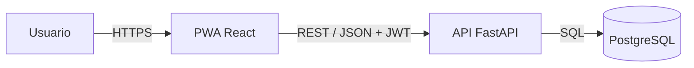
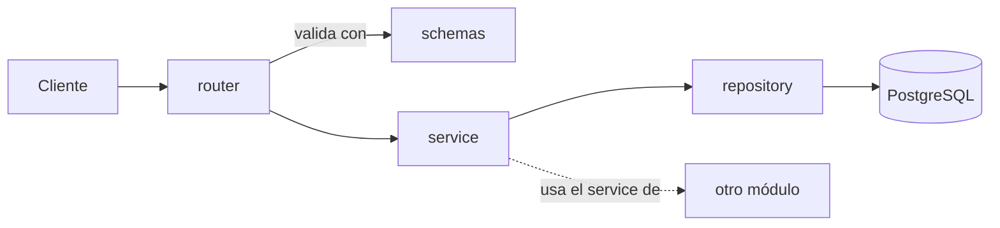

# Arquitectura — Gestor Inteligente de Vehículos

> Este documento define la arquitectura de la aplicación (capas, componentes y comunicación entre ellos) del proyecto, correspondiente a la 2.ª entrega del TPI.

---

## Parte 1 - Arquitectura de la aplicación

### 1.1 Tipo de arquitectura elegida

Se propone una **arquitectura cliente-servidor en 3 capas**:

| Capa | Componente | Responsabilidad |
|---|---|---|
| Presentación | PWA (React + TypeScript + Vite) | Interfaz de usuario, formularios de carga, gráficos y estado local |
| Aplicación (API) | API REST (FastAPI + Python 3.10+) | Autenticación, validaciones, lógica de negocio, cálculos e indicadores. Tiene su propia estructura interna (ver 1.4) |
| Datos | PostgreSQL 15+ | Persistencia relacional y consultas agregadas |



Esta separación permite desacoplar el frontend del backend, desplegar cada componente de forma independiente y mantener el contrato de la API como interfaz estable entre ambos. Cada capa se despliega como un servicio independiente en Render, de modo que la arquitectura en capas también se refleja en la topología de despliegue.

### 1.2 Arquitectura elegida

**Cliente-servidor en 3 capas con API REST y PWA desacoplada.**

El frontend y el backend se despliegan por separado, lo que da flexibilidad para escalar o modificar cada lado sin afectar al otro.

La PWA se instala desde el navegador sin depender de tiendas de aplicaciones, requisito definido en [alcance.md](alcance.md) (sección 9).

El backend expone un contrato REST reutilizable por futuros clientes (por ejemplo, una app móvil nativa en una versión posterior).

Es el estándar natural para el stack elegido (React + FastAPI). La elección de este stack también responde a un criterio de experiencia previa del equipo: en diversas asignaturas se trabajó con Python, React y FastAPI, y se busca profundizar ese conocimiento en el marco del Trabajo Final.

La decisión de implementar una PWA en lugar de una aplicación móvil nativa responde a que este tipo de solución es la habitual para aplicaciones de gestión y registro con uso ocasional, donde el usuario necesita acceder desde cualquier dispositivo sin instalar desde una tienda. Una app nativa (React Native, Flutter o similar) implicaría un tiempo adicional de aprendizaje y de investigación de un stack nuevo, que por cuestiones de tiempo quedaría fuera del plazo del Trabajo Final. Por ese motivo, el desarrollo móvil nativo queda fuera del alcance de esta versión (ver [alcance.md](alcance.md), sección 8.2), pero se contempla como una posible evolución del proyecto: el backend expone un contrato REST reutilizable, por lo que una app nativa podría incorporarse más adelante consumiendo los mismos endpoints sin requerir cambios en la API.

### 1.3 Comunicación entre capas

- **Frontend ↔ Backend:** HTTP/HTTPS con payloads JSON. Autenticación mediante JWT enviado en el header `Authorization`.

- **Backend ↔ Base de datos:** SQL sobre conexión TCP, utilizando un pool de conexiones administrado por el framework.

- **CORS:** configurado en el backend con la URL exacta del frontend desplegado, provista por la variable de entorno `CORS_ORIGINS`, desde el inicio del desarrollo (ver [viabilidad.md](viabilidad.md), sección 4.3).

- **Contrato de la API:** endpoints REST agrupados por módulo, un prefijo por módulo (`/usuarios`, `/vehiculos`, `/categorias`, `/gastos`, `/kilometraje`, `/mantenimiento`, `/indicadores`). Ver [modulos.md](modulos.md), sección 1.

### 1.4 Arquitectura interna de la API

La API se organiza en **dos dimensiones**, que responden a las dos preguntas distintas de "cómo se estructura":

1. **Por módulo (entidad del dominio):** el código se agrupa en un paquete por módulo (`usuarios`, `vehiculos`, `gastos`, etc.), de modo que todo lo relativo a un concepto está junto. Los módulos y sus relaciones se definen en [modulos.md](modulos.md).
2. **Por responsabilidad (capa), dentro de cada módulo:** cada paquete repite la misma estructura interna.

```text
backend/
└── app/
    ├── main.py              # crea la app FastAPI, registra los routers de cada módulo, CORS
    ├── core/                # infraestructura compartida, sin lógica de negocio
    │   ├── config.py        #   variables de entorno (CORS_ORIGINS, DATABASE_URL, JWT_SECRET)
    │   ├── database.py      #   engine, sesión SQLAlchemy y dependencia get_db
    │   ├── security.py      #   hash de contraseñas, creación y validación de JWT, get_usuario_actual
    │   └── errors.py        #   excepciones de dominio y su traducción a HTTP
    ├── usuarios/
    │   ├── router.py        # endpoints HTTP
    │   ├── schemas.py       # modelos Pydantic de entrada y salida
    │   ├── service.py       # lógica de negocio
    │   ├── repository.py    # acceso a datos (consultas)
    │   └── models.py        # modelos SQLAlchemy (tabla)
    ├── vehiculos/           # misma estructura
    ├── categorias/          # misma estructura
    ├── gastos/              # misma estructura
    ├── kilometraje/         # misma estructura
    ├── mantenimiento/       # misma estructura
    └── indicadores/         # sin models.py ni repository.py: no tiene tablas propias
        ├── router.py
        ├── schemas.py
        ├── service.py       #   orquesta: obtiene datos de otros módulos y aplica las reglas
        └── calculos.py      #   funciones puras (costo por km, desvío, próximo mantenimiento)
```

#### Responsabilidad de cada capa interna

| Capa | Archivo | Responsabilidad | No debe hacer |
|---|---|---|---|
| Controlador (API) | `router.py` | Recibir la solicitud HTTP, extraer parámetros y usuario autenticado, invocar al servicio y devolver la respuesta con el código HTTP correcto | Contener reglas de negocio ni consultas |
| Esquemas (DTO) | `schemas.py` | Definir y validar la forma y el formato de los datos que entran y salen (tipos, rangos, formatos) | Consultar la base |
| Servicio (lógica de negocio) | `service.py` | Reglas de negocio, verificación de pertenencia, coordinación con servicios de otros módulos, transacciones | Conocer HTTP ni escribir SQL |
| Repositorio (acceso a datos) | `repository.py` | Consultas y escrituras de las tablas **del propio módulo** | Aplicar reglas de negocio |
| Modelo | `models.py` | Mapeo de la tabla a clases SQLAlchemy | — |

La **lógica de negocio** es entonces una capa específica (el servicio) dentro de la capa de aplicación, pero no es la única responsabilidad del backend: la validación de formato vive en los esquemas, la traducción HTTP en los controladores y el acceso a datos en los repositorios. En `indicadores`, las fórmulas están aisladas en funciones puras (`calculos.py`) para poder probarlas con pruebas unitarias sin base de datos.

#### Flujo de una solicitud



#### Reglas de dependencia

1. El flujo es siempre `router → service → repository`. Un router nunca llama a un repositorio.
2. **Un módulo solo accede a sus propias tablas.** Si necesita datos de otro módulo, llama al **servicio** de ese módulo, nunca a su repositorio ni a sus modelos.
3. Las dependencias entre módulos son las del diagrama de [modulos.md](modulos.md) (sección 3) y **no pueden ser circulares**.
4. `core` no depende de ningún módulo; los módulos dependen de `core`.
5. La sesión de base de datos y el usuario autenticado se inyectan con el sistema de dependencias de FastAPI (`Depends`), lo que permite reemplazarlos en las pruebas.

#### Estructura del frontend

El frontend replica la organización por módulo para mantener el mismo lenguaje en todo el sistema:

```text
frontend/src/
├── app/                 # enrutamiento, proveedores globales, layout
├── shared/              # componentes de UI reutilizables, cliente HTTP (agrega el JWT), utilidades
└── features/
    ├── usuarios/        # pantallas de registro y login, estado de sesión
    ├── vehiculos/
    ├── categorias/
    ├── gastos/
    ├── kilometraje/
    ├── mantenimiento/
    └── indicadores/     # dashboard: gráficos y tarjetas de métricas
```

Cada carpeta de `features/` contiene sus componentes, llamadas a la API y tipos TypeScript. El dashboard es una pantalla que compone componentes de `indicadores` y, cuando hace falta, de otros módulos.

### 1.5 Relación con los módulos

- Los **siete módulos** definidos en [modulos.md](modulos.md) existen en las dos primeras capas: cada uno tiene su carpeta en `frontend/` y su paquete en `backend/`, con el mismo nombre.
- La capa de datos se apoya en el modelo de [esquema-db.md](esquema-db.md) y en el script [database/schema.sql](../database/schema.sql). Cada módulo es dueño de una tabla, salvo **Indicadores**, que no tiene tablas propias y calcula sobre los datos de los demás.
- La **validación** se realiza en todas las capas (interfaz, esquemas, servicios y base de datos), no solo en la base. El detalle de qué regla se valida en qué capa está en [esquema-db.md](esquema-db.md), sección 6.
