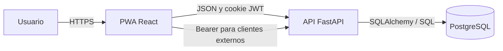
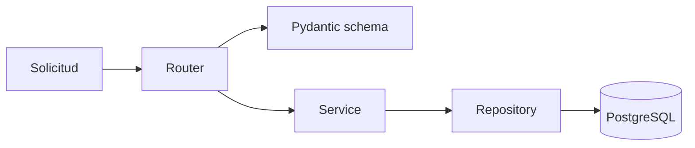

# Arquitectura

## Tipo de arquitectura

El proyecto usa una arquitectura cliente-servidor con API REST y PWA. El frontend React y el backend FastAPI se despliegan por separado y se comunican mediante JSON. PostgreSQL conserva el estado.



## Capas

| Capa | Ubicación | Responsabilidad |
|---|---|---|
| Presentación | `frontend/src/app` y `frontend/src/features` | Rutas, formularios, estado de sesión y visualización |
| Servicios compartidos frontend | `frontend/src/shared` | Cliente HTTP, errores, componentes y mensajes |
| API | `backend/app/*/router.py` | Contrato HTTP y extracción del usuario autenticado |
| Negocio | `backend/app/*/service.py` | Reglas, pertenencia e indicadores |
| Persistencia | `backend/app/*/repository.py` y `models.py` | Consultas SQLAlchemy y tablas |
| Datos | `database/schema.sql` | DDL, restricciones e índices |

## Organización del backend

Los módulos funcionales son `usuarios`, `vehiculos`, `categorias`, `gastos`, `kilometraje`, `mantenimiento` e `indicadores`.

```text
backend/app/
├── main.py
├── core/
│   ├── config.py
│   ├── database.py
│   ├── security.py
│   ├── errors.py
│   └── health.py
├── usuarios/
├── vehiculos/
├── categorias/
├── gastos/
├── kilometraje/
├── mantenimiento/
└── indicadores/
```

Dentro de cada módulo persistente existen:

- `router.py`: define los endpoints.
- `schemas.py`: valida entradas y serializa respuestas con Pydantic.
- `service.py`: aplica reglas de negocio y coordina módulos.
- `repository.py`: realiza consultas y escrituras propias.
- `models.py`: mapea las tablas SQLAlchemy.

`indicadores` no posee tablas ni repositorio propio: usa los servicios de otros módulos y contiene fórmulas puras en `calculos.py`.

## Flujo de una solicitud



Las dependencias de base de datos y usuario autenticado se inyectan con `Depends`. El servicio confirma o rechaza cambios; el repositorio ejecuta operaciones sobre sus datos.

## Comunicación y seguridad

- Los endpoints protegidos requieren el JWT.
- El frontend de navegador recibe el JWT en una cookie `HttpOnly`, `SameSite=Lax` y segura en producción.
- `Authorization: Bearer <token>` también es aceptado para Swagger y clientes externos.
- Si se envía un header Bearer inválido, no se intenta reutilizar la cookie.
- CORS se configura mediante `CORS_ORIGINS`, con una lista separada por comas.
- Un usuario solo puede operar sobre sus vehículos y los recursos asociados.

## Organización del frontend

```text
frontend/src/
├── app/       Rutas, layout y protección de rutas
├── shared/    API, componentes y mensajes reutilizables
└── features/  Usuarios, vehículos, categorías, gastos,
               kilometraje, mantenimiento e indicadores
```

El cliente compartido construye las URL `/api` y procesa errores HTTP. Los proveedores globales manejan sesión, avisos y confirmaciones.

## Enrutamiento

Las rutas públicas son `/login` y `/registro`. El resto se protege mediante `RutaProtegida`. Las principales rutas privadas permiten listar o crear vehículos, consultar el detalle y crear o editar gastos, lecturas y planes.

## Despliegue

El frontend estático usa la ruta `/api` como proxy de Render hacia FastAPI. El backend expone `/health` y `/health/db`. El plugin PWA genera el manifiesto y el service worker con actualización automática.
