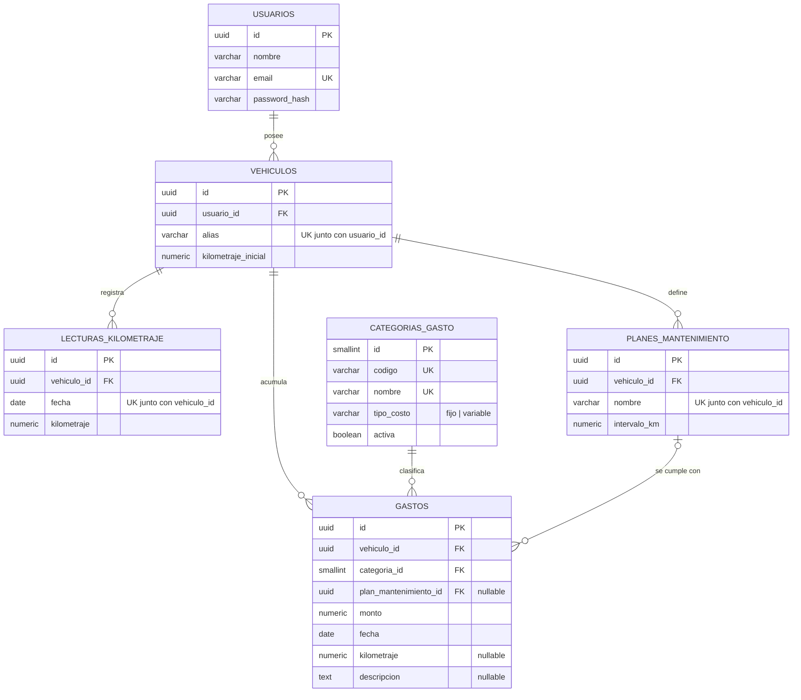

# Esquema de la base de datos

> Este documento define el modelo relacional del proyecto y reúne todo lo referente a la persistencia, validaciones y relaciones entre entidades.

---

## 1. Tecnología

La aplicación utiliza PostgreSQL 15+ como motor de base de datos relacional. El esquema completo (tablas, restricciones, índices y datos iniciales del catálogo de categorías) se encuentra en [database/schema.sql](../database/schema.sql).

## 2. Diagrama entidad-relación

El modelo tiene seis tablas, una por concepto del dominio (ver el glosario de [modulos.md](modulos.md)).

---

## 3. Diccionario de datos

### 3.1 `usuarios`

| Campo | Tipo | Restricciones | Descripción |
|---|---|---|---|
| id | UUID | PK, default `gen_random_uuid()` | Identificador único del usuario |
| nombre | varchar(150) | NOT NULL, `CHECK (btrim(nombre) <> '')` | Nombre del usuario propietario |
| email | varchar(255) | NOT NULL, UNIQUE, `CHECK` de formato | Usado para autenticación |
| password_hash | varchar(255) | NOT NULL | Contraseña hasheada |

### 3.2 `categorias_gasto`

Catálogo de categorías. Es una tabla de datos, no de estructura: las categorías se agregan o desactivan con `INSERT`/`UPDATE`.

| Campo | Tipo | Restricciones | Descripción |
|---|---|---|---|
| id | smallint | PK, `GENERATED ALWAYS AS IDENTITY` | Identificador interno |
| codigo | varchar(30) | NOT NULL, UNIQUE, `CHECK (codigo ~ '^[a-z][a-z0-9_]*$')` | Identificador estable que usa el código (ej. `combustible`). No cambia aunque cambie el nombre visible |
| nombre | varchar(60) | NOT NULL, UNIQUE, `CHECK (btrim(nombre) <> '')` | Texto mostrado al usuario |
| tipo_costo | varchar(10) | NOT NULL, `CHECK (tipo_costo IN ('fijo','variable'))` | Permite diferenciar gastos fijos de variables (necesidad de [alcance.md](alcance.md), sección 2) |
| activa | boolean | NOT NULL, default `TRUE` | Una categoría desactivada no se ofrece para gastos nuevos pero conserva el historial |

Datos iniciales: `combustible`, `mantenimiento`, `reparacion`, `seguro`, `neumaticos`, `otro`.

### 3.3 `vehiculos`

| Campo | Tipo | Restricciones | Descripción |
|---|---|---|---|
| id | UUID | PK, default `gen_random_uuid()` | Identificador único del vehículo |
| usuario_id | UUID | FK → `usuarios.id`, NOT NULL, `ON DELETE CASCADE` | Propietario del vehículo |
| alias | varchar(100) | NOT NULL, `CHECK (btrim(alias) <> '')`, UNIQUE junto con `usuario_id` | Nombre para distinguir vehículos del mismo usuario |
| kilometraje_inicial | numeric(10,2) | NOT NULL, `CHECK (kilometraje_inicial >= 0)` | Kilometraje al momento del alta. Fijo: base para el costo por km |

### 3.4 `lecturas_kilometraje`

| Campo | Tipo | Restricciones | Descripción |
|---|---|---|---|
| id | UUID | PK, default `gen_random_uuid()` | Identificador único de la lectura |
| vehiculo_id | UUID | FK → `vehiculos.id`, NOT NULL, `ON DELETE CASCADE` | Vehículo al que corresponde |
| fecha | date | NOT NULL, `CHECK (fecha <= CURRENT_DATE)`, UNIQUE junto con `vehiculo_id` | Día en que se leyó el odómetro. Una lectura por vehículo y día |
| kilometraje | numeric(10,2) | NOT NULL, `CHECK (kilometraje >= 0)` | Valor del odómetro. La **última lectura** es el kilometraje actual del vehículo |

### 3.5 `planes_mantenimiento`

| Campo | Tipo | Restricciones | Descripción |
|---|---|---|---|
| id | UUID | PK, default `gen_random_uuid()` | Identificador único del plan |
| vehiculo_id | UUID | FK → `vehiculos.id`, NOT NULL, `ON DELETE CASCADE` | Vehículo al que aplica |
| nombre | varchar(100) | NOT NULL, `CHECK (btrim(nombre) <> '')`, UNIQUE junto con `vehiculo_id` | Qué se mantiene (ej. "Cambio de aceite") |
| intervalo_km | numeric(10,2) | NOT NULL, `CHECK (intervalo_km > 0)` | Cada cuántos km debe repetirse (cargado por el usuario, sin reglas por marca o modelo) |

Tiene además `UNIQUE (id, vehiculo_id)`, redundante con la PK, que existe únicamente como destino de la FK compuesta de `gastos` (ver 5.4).

### 3.6 `gastos`

| Campo | Tipo | Restricciones | Descripción |
|---|---|---|---|
| id | UUID | PK, default `gen_random_uuid()` | Identificador único del gasto |
| vehiculo_id | UUID | FK → `vehiculos.id`, NOT NULL, `ON DELETE CASCADE` | Vehículo al que corresponde el gasto |
| categoria_id | smallint | FK → `categorias_gasto.id`, NOT NULL, `ON DELETE RESTRICT` | Categoría del gasto |
| plan_mantenimiento_id | UUID | NULLABLE, FK compuesta `(plan_mantenimiento_id, vehiculo_id)` → `planes_mantenimiento(id, vehiculo_id)`, `ON DELETE SET NULL` | Plan de mantenimiento que este gasto dejó cumplido. Opcional |
| monto | numeric(12,2) | NOT NULL, `CHECK (monto > 0)` | Monto del gasto |
| fecha | date | NOT NULL, `CHECK (fecha <= CURRENT_DATE)` | Fecha del gasto |
| kilometraje | numeric(10,2) | NULLABLE, `CHECK (kilometraje IS NULL OR kilometraje >= 0)` | Odómetro al momento del gasto. Opcional, salvo si se asocia a un plan (`CHECK (plan_mantenimiento_id IS NULL OR kilometraje IS NOT NULL)`) |
| descripcion | text | NULLABLE | Detalle opcional |

---

## 4. Relaciones

- **`usuarios` 1:N `vehiculos`**: un usuario gestiona uno o varios vehículos; cada vehículo pertenece a un único usuario.
- **`vehiculos` 1:N `lecturas_kilometraje`**: el historial del odómetro de cada vehículo.
- **`vehiculos` 1:N `planes_mantenimiento`**: un vehículo puede tener varios planes (aceite, filtros, distribución, etc.), cada uno con su propio intervalo.
- **`vehiculos` 1:N `gastos`**: cada gasto queda asociado a un único vehículo, lo que permite calcular indicadores por vehículo de forma independiente.
- **`categorias_gasto` 1:N `gastos`**: cada gasto tiene exactamente una categoría del catálogo.
- **`planes_mantenimiento` 0..1:N `gastos`**: un gasto de mantenimiento puede registrarse como cumplimiento de un plan; un plan acumula varios gastos a lo largo del tiempo (uno por cada vez que se realizó).

---

## 5. Decisiones de diseño

### 5.1 De 3 a 6 tablas: qué se separó y por qué

La versión anterior tenía tres tablas (`usuarios`, `vehiculos`, `gastos`) y concentraba conceptos de dominio distintos dentro de ellas: un `enum` para las categorías, el kilometraje y el intervalo de mantenimiento como columnas de `vehiculos`. Se separaron cuatro conceptos que ya existían en el dominio y que de otro modo quedaban escondidos en columnas:

| Antes | Ahora | Motivo |
|---|---|---|
| `enum gasto_categoria` | Tabla `categorias_gasto` | Agregar una categoría (por ejemplo `patente`) es un `INSERT`; con un `enum` implicaba una migración (`ALTER TYPE`) y un despliegue. Además permite atributos propios de la categoría (`tipo_costo`) y desactivar categorías sin perder historial |
| `vehiculos.kilometraje_actual` (editable) | Tabla `lecturas_kilometraje` | Se guarda el historial del odómetro en lugar de pisar un único valor. `kilometraje_actual` pasa a ser un dato **derivado** (la última lectura), por lo que no puede quedar desactualizado respecto del historial. Habilita calcular costo por km en cualquier período, no solo el acumulado |
| `vehiculos.intervalo_mantenimiento_km` | Tabla `planes_mantenimiento` | Un vehículo no tiene un único mantenimiento: aceite, filtros y distribución se repiten con intervalos distintos. Un campo único obligaba a estimar un solo "próximo mantenimiento" para todo el auto |
| (no existía) | `gastos.plan_mantenimiento_id` + `gastos.kilometraje` | Para estimar el próximo mantenimiento hay que saber **cuándo se hizo el último**. Se registra al cargar el gasto, no en un registro aparte |

Cada separación responde a una funcionalidad del MVP ya definida en [alcance.md](alcance.md) (sección 8.1); **no se agregan funcionalidades nuevas**. Lo que cambia es que el modelo expresa conceptos del dominio que antes estaban comprimidos.

### 5.2 Dónde está la complejidad de la aplicación

El modelo es deliberadamente normalizado pero no extenso: la complejidad de la aplicación está en la capa de servicios y en las consultas, no en el número de tablas. Se concentra en el módulo **Indicadores** (ver [modulos.md](modulos.md)):

- Costo real por km: `SUM(gastos.monto) / (última lectura − kilometraje_inicial)`, con manejo de casos sin datos suficientes.
- Comparación del gasto de combustible contra el promedio histórico propio (agregación mensual por vehículo y categoría, y criterio de desvío).
- Estimación del próximo mantenimiento por plan: último `gastos.kilometraje` del plan + `intervalo_km`, comparado contra el kilometraje actual.
- Heurística "reparar o reemplazar" sobre gasto acumulado y kilometraje.

### 5.3 Decisiones que se mantienen

- **Gastos en una única tabla** con referencia a la categoría, en vez de una tabla por categoría: todas comparten los mismos atributos y los indicadores se resuelven agrupando por categoría.
- **Sin campos específicos por categoría** (litros o precio por litro en combustible): ninguna funcionalidad del MVP los requiere; el costo por km usa el monto total.
- **El kilometraje no se exige en cada gasto**: se mantiene la decisión original de no depender de que el usuario cargue el odómetro en cada gasto, dado que los datos históricos pueden ser incompletos. `gastos.kilometraje` es opcional y solo es obligatorio cuando el gasto se marca como cumplimiento de un plan, que es el único caso en que el dato es necesario.
- **Heurística "reparar o reemplazar"** se resuelve con los datos ya modelados, sin campos adicionales. Se excluyen explícitamente valor de mercado y tasación.

### 5.4 Decisiones técnicas

- **FK compuesta `(plan_mantenimiento_id, vehiculo_id)`:** impide a nivel de base que un gasto del vehículo A quede asociado a un plan del vehículo B. Es una regla entre dos filas de tablas distintas que un `CHECK` no puede expresar y que de otro modo dependería solo del backend.
- **`ON DELETE CASCADE`** entre usuario → vehículo → gastos / lecturas / planes: los datos de un vehículo no tienen sentido sin él.
- **`ON DELETE RESTRICT`** en `gastos.categoria_id`: una categoría con gastos no puede borrarse. Se desactiva (`activa = FALSE`).
- **`ON DELETE SET NULL (plan_mantenimiento_id)`** (sintaxis de PostgreSQL 15+): si el usuario elimina un plan, sus gastos se conservan y solo pierden la asociación. Se anula únicamente esa columna, no `vehiculo_id`.
- **`categoria.codigo` como identificador estable:** el módulo Indicadores necesita saber cuál categoría es combustible para la comparación con el promedio. Lo hace por `codigo = 'combustible'`, no por `id` ni por `nombre`. Esto es un acoplamiento consciente: la categoría `combustible` debe existir en el catálogo, y por eso viene en los datos iniciales del script.
- **Claves de `categorias_gasto` como `smallint` identity y no UUID:** es un catálogo chico, de crecimiento controlado por el equipo y referenciado desde la tabla más grande del modelo; no se expone como recurso creado por usuarios.
- **`tipo_costo` como `CHECK` y no como tabla:** `fijo`/`variable` es una clasificación cerrada del dominio, a diferencia de las categorías, que sí deben poder crecer.
- Los tipos numéricos y longitudes se definieron según necesidades técnicas de implementación y podrán ajustarse sin modificar el modelo conceptual.

---

## 6. Validación de datos: se valida en todas las capas

La base de datos es la **última línea de defensa**, no la única. Cada regla se valida lo más arriba posible para dar feedback inmediato al usuario y proteger al backend, y se refuerza en las capas inferiores. Algunas reglas, además, **no pueden expresarse en la base** y viven únicamente en el backend.

| Regla | UI (frontend) | API (esquemas Pydantic) | Servicio (lógica de negocio) | Base de datos |
|---|---|---|---|---|
| Monto del gasto mayor a cero | Atributo `min` y mensaje | `gt=0` | — | `CHECK (monto > 0)` |
| Fecha no futura | Atributo `max` en el selector | Validador de fecha | — | `CHECK (fecha <= CURRENT_DATE)` |
| Email con formato válido | Validación de formato | `EmailStr` | — | `CHECK` con expresión regular |
| Email no repetido | — | — | Consulta previa; responde 409 | `UNIQUE` |
| Campos de texto no vacíos | Campo obligatorio | `min_length=1` tras `strip` | — | `CHECK (btrim(x) <> '')` |
| Gasto asociado a un plan requiere kilometraje | Campo obligatorio al elegir un plan | Validador de modelo | — | `CHECK (plan IS NULL OR km IS NOT NULL)` |
| El plan elegido pertenece al mismo vehículo del gasto | El selector solo lista planes del vehículo | — | Verifica con el módulo Mantenimiento | FK compuesta |
| La categoría existe y está activa | El selector solo lista activas | — | Rechaza categorías inactivas (la base solo verifica existencia con la FK) | FK |
| El vehículo pertenece al usuario autenticado | — | — | **Obligatoria**: toda operación verifica pertenencia | No aplica: la FK solo garantiza existencia |
| Una lectura de km no puede ser menor que el `kilometraje_inicial` ni retroceder respecto de lecturas anteriores | Aviso al ingresar | — | **Única capa que la valida** | No expresable con `CHECK` (compara contra otras filas) |

Dos consecuencias de este diseño:

- La regla `kilometraje_actual >= kilometraje_inicial` del esquema anterior era un `CHECK` porque ambos valores estaban en la misma fila. Al pasar el odómetro a su propia tabla, esa regla se mueve al servicio. Es un ejemplo concreto de por qué la validación no puede delegarse solo a la base.
- La validación en base sigue siendo valiosa: protege ante inserciones por fuera de la API (scripts de migración, datos de demostración, futuras interfaces) y ante errores del backend.

---

## 7. Índices y su justificación

PostgreSQL crea automáticamente un índice por cada `PRIMARY KEY` y `UNIQUE`. Esos índices **no se duplican**: en varios casos, la restricción de unicidad es a la vez el índice que necesita una consulta. Las claves foráneas, en cambio, **no** generan índice en PostgreSQL, por eso se evalúa cada una.

| Índice | Tipo | Consulta que sirve | Por qué esa forma |
|---|---|---|---|
| `usuarios(email)` | UNIQUE | Login: buscar usuario por email | Impide emails duplicados y es la búsqueda del login |
| `categorias_gasto(codigo)`, `(nombre)` | UNIQUE | Resolver una categoría por su código (ej. `combustible`) | Garantiza catálogo sin duplicados |
| `vehiculos(usuario_id, alias)` | UNIQUE | "Vehículos de un usuario" (pantalla principal) | Impide dos vehículos con el mismo alias para un usuario y, por empezar con `usuario_id`, cubre la FK sin crear otro índice. También acelera el `CASCADE` al borrar un usuario |
| `lecturas_kilometraje(vehiculo_id, fecha)` | UNIQUE | Última lectura de un vehículo (`ORDER BY fecha DESC LIMIT 1`) y lecturas de un período | Impide dos lecturas el mismo día; recorrer el índice hacia atrás da la última lectura sin ordenar |
| `planes_mantenimiento(vehiculo_id, nombre)` | UNIQUE | Planes de un vehículo | Impide planes repetidos y cubre la FK a `vehiculos` |
| `planes_mantenimiento(id, vehiculo_id)` | UNIQUE | No es de consulta: destino de la FK compuesta de `gastos` | PostgreSQL exige una restricción única sobre las columnas referenciadas |
| `idx_gastos_vehiculo_fecha` `(vehiculo_id, fecha DESC)` | B-tree | Listado de gastos de un vehículo, del más reciente al más antiguo, y total por rango de fechas | Todas las consultas del sistema están acotadas a un vehículo; `vehiculo_id` va primero y `fecha` permite filtrar por rango y ordenar sin paso extra. También cubre la FK `gastos → vehiculos` |
| `idx_gastos_vehiculo_categoria_fecha` `(vehiculo_id, categoria_id, fecha)` | B-tree | Gasto acumulado por categoría y comparación de combustible contra el promedio histórico (filtra por vehículo y categoría, agrupa por período) | El orden sigue la forma de las consultas: igualdad en `vehiculo_id` y `categoria_id`, luego rango en `fecha` |
| `idx_gastos_plan_km` `(plan_mantenimiento_id, kilometraje DESC)` | B-tree **parcial** (`WHERE plan_mantenimiento_id IS NOT NULL`) | Último mantenimiento realizado de un plan, para estimar el próximo | Solo indexa los gastos asociados a un plan (una minoría), por lo que es mucho más chico. Cubre la FK compuesta hacia `planes_mantenimiento` |

Índices **que se evaluaron y se descartaron**, respecto de la versión anterior:

- `gastos(vehiculo_id)` solo: es redundante, ya que `idx_gastos_vehiculo_fecha` empieza por esa misma columna.
- `gastos(fecha)` solo: ninguna consulta del sistema filtra por fecha sin acotar antes por vehículo.
- `gastos(categoria_id)` solo: hay entre 6 y unas pocas decenas de categorías, por lo que el índice discrimina muy poco, y siempre se consulta junto con el vehículo (lo cubre el compuesto). No se indexa la FK hacia `categorias_gasto` porque las categorías no se borran (se desactivan), por lo que no hay verificaciones de borrado que acelerar.

---

## 8. Reglas de integridad

- Todas las entidades poseen una clave primaria.
- Las relaciones se implementan mediante claves foráneas; la asociación gasto-plan además garantiza mismo vehículo.
- El correo del usuario debe ser único y cumplir formato válido.
- El alias del vehículo es obligatorio, no vacío y único dentro de los vehículos de un usuario.
- Los kilometrajes (inicial, lecturas y el del gasto) son no negativos. La coherencia entre lecturas y `kilometraje_inicial` la valida el servicio.
- Los montos de los gastos deben ser mayores a cero.
- Las fechas de gastos y lecturas no pueden ser futuras.
- Un gasto asociado a un plan debe informar kilometraje.
- Una categoría con gastos no puede eliminarse, solo desactivarse.
- Al eliminar un usuario, se eliminan sus vehículos y todo lo asociado a ellos. Al eliminar un plan, sus gastos se conservan.

---

## 9. Validación de cobertura contra el MVP

| Funcionalidad | Resuelta con |
|---|---|
| Gestión de uno o varios vehículos por usuario | `vehiculos.usuario_id` |
| Registro de combustible / mantenimiento / reparaciones / otros gastos | `gastos` + `categorias_gasto` |
| Kilometraje actual del vehículo | Última fila de `lecturas_kilometraje` del vehículo |
| Costo real por km | `SUM(gastos.monto) / (última lectura − vehiculos.kilometraje_inicial)` |
| Gasto acumulado por categoría | `gastos` agrupado por `categoria_id`, unido a `categorias_gasto` |
| Diferenciar gastos fijos de variables | `categorias_gasto.tipo_costo` |
| Comparación de combustible vs. promedio histórico propio | `gastos` filtrado por la categoría `combustible`, agrupado por `vehiculo_id` y mes |
| Estimación de próximo mantenimiento por kilometraje | `planes_mantenimiento.intervalo_km` + último `gastos.kilometraje` del plan + última lectura |
| Heurística "reparar o reemplazar" | Agregaciones sobre `gastos`, `lecturas_kilometraje` y `vehiculos`, sin datos externos |
| Reglas de integridad | Restricciones `CHECK`, `UNIQUE`, `FK` en `schema.sql`, más validaciones de las capas superiores (sección 6) |
