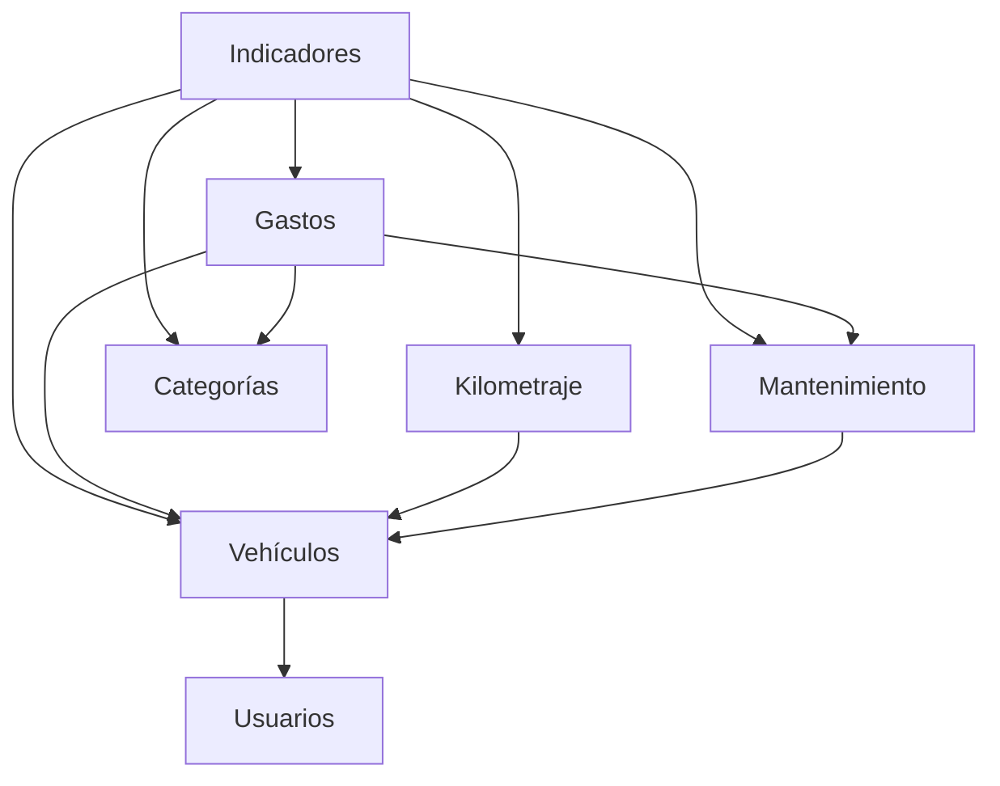

# Definición y Listado de Módulos

Cada módulo reúne el concepto del dominio y su interfaz, reglas y persistencia. Los nombres se mantienen iguales en documentación, API y carpetas.

| Módulo | Concepto | Tabla | Prefijo |
|---|---|---|---|
| Usuarios | Registro, login y sesión | `usuarios` | `/usuarios` |
| Vehículos | Vehículos propios del usuario | `vehiculos` | `/vehiculos` |
| Categorías | Catálogo activo de tipos de gasto | `categorias_gasto` | `/categorias` |
| Gastos | Gastos asociados a vehículos | `gastos` | `/gastos` |
| Kilometraje | Historial del odómetro | `lecturas_kilometraje` | `/kilometraje` |
| Mantenimiento | Planes por intervalo de km | `planes_mantenimiento` | `/mantenimiento` |
| Indicadores | Métricas calculadas | Sin tabla propia | `/indicadores` |

## Usuarios

- `POST /usuarios/registro`: crea la cuenta.
- `POST /usuarios/login`: valida credenciales y devuelve el token.
- `POST /usuarios/sesion`: establece la cookie HttpOnly.
- `DELETE /usuarios/sesion`: elimina la cookie.
- `GET /usuarios/me`: devuelve el usuario autenticado.

La contraseña se almacena hasheada con bcrypt. El token JWT contiene el id del usuario, fecha de emisión y vencimiento.

## Vehículos

- CRUD completo bajo `/vehiculos`.
- Conserva `alias` y `kilometraje_inicial`.
- Todas las operaciones están acotadas al usuario autenticado.
- Su servicio es usado por los otros módulos para verificar pertenencia.

## Categorías

- `GET /categorias` devuelve las categorías activas.
- El catálogo inicial contiene combustible, mantenimiento, reparación, seguro, neumáticos y otros.
- Las categorías son administradas por datos o scripts, no por una interfaz administrativa.

## Gastos

- CRUD bajo `/gastos`.
- Cada gasto tiene vehículo, categoría, monto, fecha y descripción opcional.
- Puede tener un plan de mantenimiento y kilometraje asociado.
- Valida que el plan pertenezca al vehículo y que exista la categoría activa.

## Kilometraje

- CRUD bajo `/kilometraje`.
- Permite consultar la última lectura.
- Impide una lectura menor que el `kilometraje_inicial` o retroceder respecto de lecturas anteriores.
- Una lectura por vehículo y fecha.

## Mantenimiento

- CRUD bajo `/mantenimiento`.
- Cada plan tiene nombre e intervalo positivo en kilómetros.
- Los nombres son únicos dentro de un vehículo.
- Eliminar un plan conserva sus gastos y elimina únicamente la asociación.

## Indicadores

Endpoints disponibles:

| Endpoint | Resultado |
|---|---|
| `/indicadores/resumen` | Resumen agregado del vehículo |
| `/indicadores/costo-por-km` | Gasto total dividido por km recorridos |
| `/indicadores/gasto-por-categoria` | Acumulado y distribución por categoría |
| `/indicadores/alerta-combustible` | Comparación contra el promedio histórico propio |
| `/indicadores/proximo-mantenimiento` | Próximo km estimado por plan |
| `/indicadores/reparar-o-reemplazar` | Orientación heurística |

Los indicadores son solo lectura y devuelven estados vacíos o insuficientes cuando no hay datos.

## Relaciones

Un módulo usa el servicio de otro para datos compartidos. Los routers no llaman directamente a repositorios ajenos.

## Estado de implementación

- [x] Usuarios
- [x] Vehículos
- [x] Categorías
- [x] Gastos
- [x] Kilometraje
- [x] Mantenimiento
- [x] Indicadores
