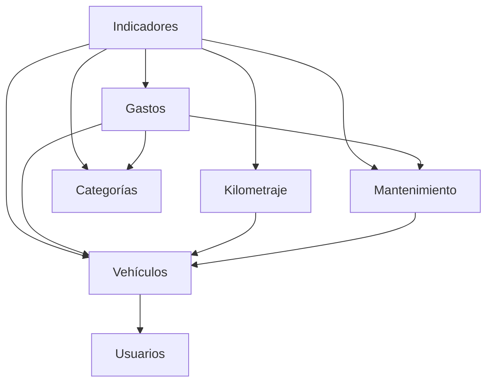
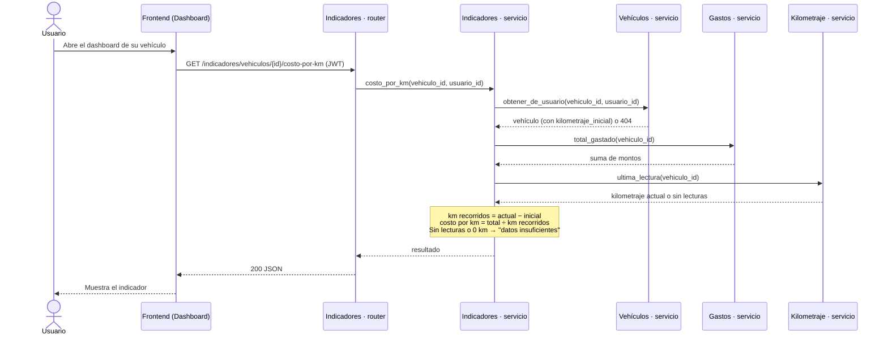

# Definición y Listado de Módulos

> Este documento define los módulos de la aplicación. Un **módulo** es un componente del dominio: reúne todos los archivos y responsabilidades de un mismo concepto (interfaz, API, lógica y persistencia) y usa los servicios de otros módulos cuando los necesita. Los módulos **no se dividen por capa**: la organización por capas se describe dentro de cada módulo en [arquitectura.md](arquitectura.md) (sección 1.4).

---

## 1. Nomenclatura de los módulos

Cada concepto del dominio tiene **un solo nombre**, y ese mismo nombre se usa en la documentación, la API, la base de datos y las carpetas del código.

| Módulo | Concepto | Tabla | Prefijo de la API | Carpeta backend | Carpeta frontend |
|---|---|---|---|---|---|
| **Usuarios** | Persona propietaria; registro, inicio de sesión y perfil | `usuarios` | `/usuarios` | `backend/app/usuarios/` | `frontend/src/features/usuarios/` |
| **Vehículos** | Vehículo del usuario (alta, edición, baja) | `vehiculos` | `/vehiculos` | `backend/app/vehiculos/` | `frontend/src/features/vehiculos/` |
| **Categorías** | Catálogo de categorías de gasto | `categorias_gasto` | `/categorias` | `backend/app/categorias/` | `frontend/src/features/categorias/` |
| **Gastos** | Gasto registrado sobre un vehículo | `gastos` | `/gastos` | `backend/app/gastos/` | `frontend/src/features/gastos/` |
| **Kilometraje** | Historial de lecturas del odómetro | `lecturas_kilometraje` | `/kilometraje` | `backend/app/kilometraje/` | `frontend/src/features/kilometraje/` |
| **Mantenimiento** | Planes de mantenimiento con su intervalo en km | `planes_mantenimiento` | `/mantenimiento` | `backend/app/mantenimiento/` | `frontend/src/features/mantenimiento/` |
| **Indicadores** | Costo por km, gasto por categoría, alertas, próximo mantenimiento y orientación reparar/reemplazar | *(ninguna: calcula sobre datos de otros módulos)* | `/indicadores` | `backend/app/indicadores/` | `frontend/src/features/indicadores/` |

Dos aclaraciones de terminología:

- **Alertas** no es un módulo aparte: son un tipo de indicador (por ejemplo, el desvío del gasto de combustible respecto del promedio histórico). Se resuelven dentro de **Indicadores**.
- **Reportes** (módulo de la versión anterior) desaparece: eran consultas agregadas, que ahora pertenecen al módulo dueño de los datos (Gastos) o al que las interpreta (Indicadores).

## 2. Descripción de los módulos

### Usuarios
- **Responsabilidad:** registro, inicio de sesión (emisión del token JWT) y datos del perfil.
- **Endpoints:** `POST /usuarios/registro`, `POST /usuarios/login`, `GET /usuarios/me`.
- **Usa:** nada de otros módulos. La validación del token y la obtención del usuario autenticado son infraestructura compartida (`core`), no del módulo.
- **Nota:** la recuperación de contraseña, mencionada en la versión anterior, requeriría envío de correos (integración externa) y queda fuera del alcance del MVP definido en [alcance.md](alcance.md).

### Vehículos
- **Responsabilidad:** alta, edición, listado y baja de vehículos del usuario autenticado. Es el módulo que **verifica la pertenencia**: expone una operación "obtener el vehículo X del usuario Y" que el resto de los módulos usa antes de operar sobre un vehículo.
- **Usa:** Usuarios (identidad del propietario).

### Categorías
- **Responsabilidad:** consulta del catálogo de categorías de gasto activas. En el MVP el catálogo se administra con `INSERT`/`UPDATE` sobre la tabla; no hay pantalla de administración.
- **Usa:** nada.

### Gastos
- **Responsabilidad:** registrar, editar, listar y eliminar gastos de un vehículo. Expone consultas agregadas sobre sus propios datos (total, total por categoría, serie mensual) que usa Indicadores.
- **Usa:** Vehículos (pertenencia), Categorías (categoría válida y activa) y Mantenimiento (cuando el gasto se asocia a un plan).

### Kilometraje
- **Responsabilidad:** registrar lecturas del odómetro y entregar la última lectura (kilometraje actual) de un vehículo. Valida que una lectura no retroceda respecto de las anteriores ni del `kilometraje_inicial`.
- **Usa:** Vehículos.

### Mantenimiento
- **Responsabilidad:** alta, edición y baja de los planes de mantenimiento de un vehículo (nombre e intervalo en km).
- **Usa:** Vehículos.

### Indicadores
- **Responsabilidad:** concentra la lógica analítica: costo real por km, gasto acumulado por categoría, comparación del combustible contra el promedio histórico propio, estimación del próximo mantenimiento por plan y orientación "reparar o reemplazar". No tiene tablas propias ni escribe datos: es de solo lectura.
- **Usa:** Vehículos, Gastos, Categorías, Kilometraje y Mantenimiento.

## 3. Relaciones entre módulos

Las flechas indican "usa los servicios de". No hay dependencias circulares: Indicadores está en la cima porque combina datos de todos los demás, y Usuarios en la base porque no depende de nadie.

Regla de diseño que evita el ciclo Gastos ↔ Mantenimiento: **Gastos** conoce el plan al que se asocia un gasto (lo valida con Mantenimiento), pero **Mantenimiento** no conoce los gastos. El cálculo del próximo mantenimiento, que necesita ambos, vive en **Indicadores**.

## 4. Casos de uso y módulos involucrados

| Caso de uso | Módulo principal | También participan |
|---|---|---|
| CU1. Registrarse e iniciar sesión | Usuarios | — |
| CU2. Gestionar mis vehículos | Vehículos | Usuarios |
| CU3. Registrar un gasto | Gastos | Vehículos, Categorías, y Mantenimiento si se asocia a un plan |
| CU4. Registrar una lectura de kilometraje | Kilometraje | Vehículos |
| CU5. Definir un plan de mantenimiento | Mantenimiento | Vehículos |
| CU6. Consultar el costo real por km | Indicadores | Vehículos, Gastos, Kilometraje |
| CU7. Ver el gasto acumulado por categoría | Indicadores | Vehículos, Gastos, Categorías |
| CU8. Ver la alerta de gasto de combustible | Indicadores | Vehículos, Gastos, Categorías |
| CU9. Ver el próximo mantenimiento | Indicadores | Vehículos, Mantenimiento, Gastos, Kilometraje |
| CU10. Obtener la orientación reparar o reemplazar | Indicadores | Vehículos, Gastos, Kilometraje |

## 5. Flujo crítico: consultar el costo real por km

Se elige este flujo porque es el **valor central del producto** ([alcance.md](alcance.md), sección 7) y el que cruza más módulos: necesita datos de gastos, de kilometraje y del vehículo, y respeta la pertenencia del recurso.

Qué demuestra este flujo: (1) cada módulo se consulta a través de su **servicio**, nunca de sus tablas; (2) la verificación de pertenencia ocurre una sola vez, en Vehículos; (3) el cálculo vive en Indicadores, no en la base ni en el frontend; (4) el caso "datos insuficientes" se maneja explícitamente, como pide el plan de trabajo para usuarios sin historial.

## 6. Interfaces entre módulos

| Módulo | Consume | Proporciona |
|---|---|---|
| Usuarios | — | Registro, sesión y token JWT |
| Vehículos | Usuarios | Verificación de pertenencia; CRUD de vehículos |
| Categorías | — | Catálogo de categorías activas |
| Gastos | Vehículos, Categorías, Mantenimiento | CRUD de gastos; totales, totales por categoría y series mensuales |
| Kilometraje | Vehículos | Registro de lecturas; kilometraje actual |
| Mantenimiento | Vehículos | CRUD de planes de mantenimiento |
| Indicadores | Vehículos, Gastos, Categorías, Kilometraje, Mantenimiento | Costo por km, gasto por categoría, alertas, próximo mantenimiento, orientación reparar/reemplazar |

## 7. Permisos

- Cada usuario solo puede acceder a sus propios vehículos y a todo lo asociado a ellos (gastos, lecturas, planes e indicadores).
- Los endpoints protegidos requieren un token JWT válido; solo `registro` y `login` son públicos.
- Todo módulo que opere sobre un vehículo debe verificar su pertenencia mediante el servicio de **Vehículos**. La base de datos garantiza que el vehículo exista, pero no que pertenezca al usuario que consulta (ver [esquema-db.md](esquema-db.md), sección 6).

## 8. Estado de implementación

- [ ] Usuarios
- [ ] Vehículos
- [ ] Categorías
- [ ] Gastos
- [ ] Kilometraje
- [ ] Mantenimiento
- [ ] Indicadores
